# E-Commerce Sales Data Analysis Using Hadoop MapReduce

Analysis of the [UCI Online Retail dataset](https://archive.ics.uci.edu/dataset/352/online+retail)
(541,909 transactions from a UK-based online retailer, Dec 2010 – Dec 2011) using
**Hadoop MapReduce** with **Python** mappers/reducers via **Hadoop Streaming**, and
**Matplotlib** for the graphs.

## Workflow

```
Online Retail Dataset (.xlsx)
        │
        ▼
  Data Cleaning  (scripts/clean_data.py → tab-separated file)
        │
        ▼
      HDFS  (hdfs dfs -put)
        │
        ▼
 Hadoop MapReduce (Hadoop Streaming, 4 jobs)
   Mapper ──► Combiner ──► Shuffle & Sort ──► Reducer
        │
        ▼
 Results (part-00000 per job)  ──►  Verification (pandas cross-check)
        │
        ▼
 Graphs + ranked summary tables (scripts/visualize.py)
        │
        ▼
 FastAPI backend (backend/main.py)  ──►  Next.js frontend (frontend/)
```

## MapReduce jobs

| # | Job | Mapper emits | Reducer outputs |
|---|-----|--------------|-----------------|
| 1 | **Sales by Product** – which products generate the highest revenue | `Description → Quantity × UnitPrice` | total revenue per product |
| 2 | **Sales by Country** – which countries generate the most revenue | `Country → Quantity × UnitPrice` | total revenue per country |
| 3 | **Top-Selling Products** – products with the highest quantity sold | `Description → Quantity` | total units per product |
| 4 | **Monthly Sales Analysis** – how revenue changes month by month | `YYYY-MM → Quantity × UnitPrice` | total revenue per month |

Each reducer is a sum over a key-sorted stream, which is associative and
commutative, so the same script is also used as the **combiner** to cut down the
data sent across the network during the shuffle.

Example for job 2 (Sales by Country):

```
Input line   : 536370  22728  ALARM CLOCK BAKELIKE PINK  24  2010-12-01 08:45  3.75  12583  France
Mapper       : France          90.00
Shuffle/Sort : France          [90.00, 29.50, ...]      (all values for a key arrive together)
Reducer      : France          182697.39
```

## Data cleaning

`scripts/clean_data.py` converts the Excel file into a tab-separated file
(tabs are safe because some product descriptions contain commas):

| Step | Rows left |
|------|----------:|
| Raw dataset | 541,909 |
| Drop missing descriptions | 540,455 |
| Drop cancelled invoices (`InvoiceNo` starts with `C`) **and the order lines they reverse** | 527,979 |
| Drop `Quantity <= 0` or `UnitPrice <= 0` | 526,919 |
| Drop non-product stock codes (postage, bank charges, fees, manual adjustments) | 524,688 |
| Drop exact duplicates | **519,516** |

Removing the reversed order lines matters: the dataset has a few huge orders that
were cancelled minutes later (e.g. 80,995 × "PAPER CRAFT, LITTLE BIRDIE"). If you
drop only the cancellation rows, those orders still show up as the top-selling
products even though they never sold.

## Results

| Metric | Value |
|--------|------:|
| Total revenue (after cleaning) | **£9,815,291.49** |
| Units sold | 5,333,762 |
| Distinct products | 3,998 |
| Countries | 38 |
| Top product by revenue | Regency Cakestand 3 Tier (£169,505.64) |
| Top product by units | World War 2 Gliders Asstd Designs (54,711) |
| Top country | United Kingdom (84.71% of revenue) |
| Best month | November 2011 (£1,436,127.66) |

The graphs below are made by `scripts/visualize.py` with Matplotlib and saved in
[results/graphs/](results/graphs/). The same four PNGs are shown in the
frontend's gallery.

### 1. Sales by Product
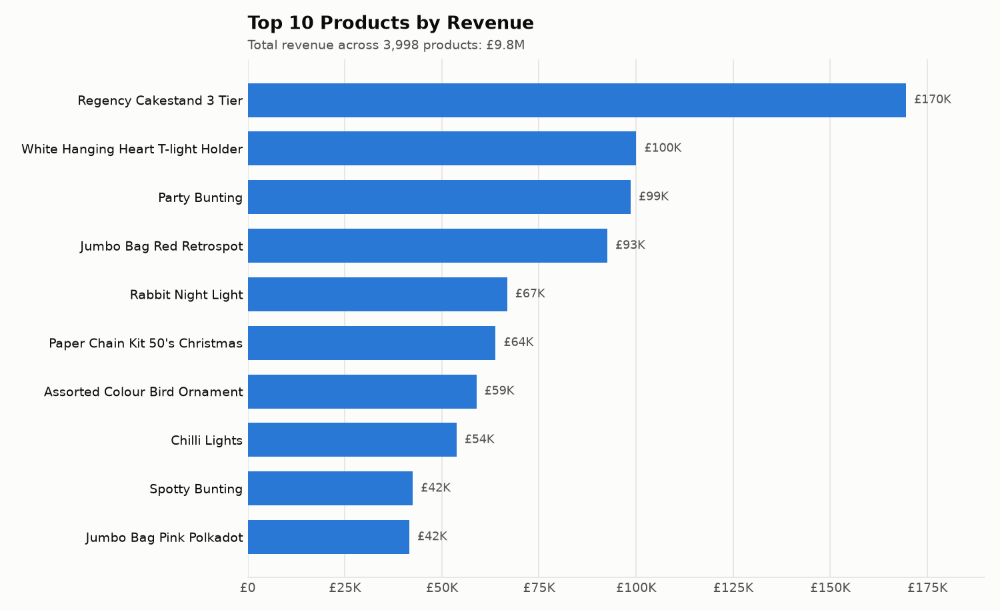

| Rank | Product | Revenue | Share |
|-----:|---------|--------:|------:|
| 1 | Regency Cakestand 3 Tier | £169,505.64 | 1.73% |
| 2 | White Hanging Heart T-Light Holder | £100,052.42 | 1.02% |
| 3 | Party Bunting | £98,610.18 | 1.00% |
| 4 | Jumbo Bag Red Retrospot | £92,595.77 | 0.94% |
| 5 | Rabbit Night Light | £66,807.63 | 0.68% |
| 6 | Paper Chain Kit 50's Christmas | £63,834.94 | 0.65% |
| 7 | Assorted Colour Bird Ornament | £58,878.61 | 0.60% |
| 8 | Chilli Lights | £53,761.61 | 0.55% |
| 9 | Spotty Bunting | £42,493.68 | 0.43% |
| 10 | Jumbo Bag Pink Polkadot | £41,609.47 | 0.42% |

Revenue is spread thinly: even the top product earns under 2% of the total.

### 2. Sales by Country
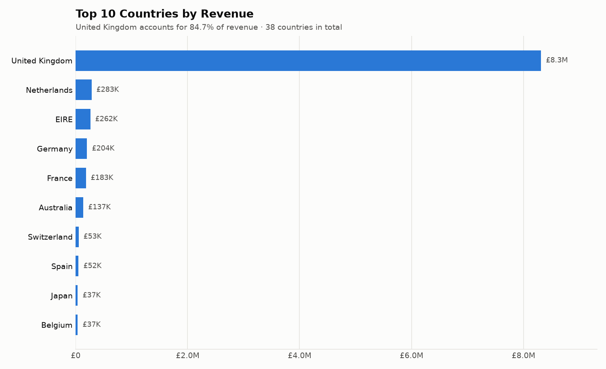

| Rank | Country | Revenue | Share |
|-----:|---------|--------:|------:|
| 1 | United Kingdom | £8,314,970.56 | 84.71% |
| 2 | Netherlands | £283,443.54 | 2.89% |
| 3 | EIRE | £262,162.03 | 2.67% |
| 4 | Germany | £203,605.08 | 2.07% |
| 5 | France | £182,697.39 | 1.86% |
| 6 | Australia | £137,062.85 | 1.40% |
| 7 | Switzerland | £52,712.50 | 0.54% |
| 8 | Spain | £52,029.97 | 0.53% |
| 9 | Japan | £37,314.37 | 0.38% |
| 10 | Belgium | £36,813.69 | 0.38% |

The United Kingdom accounts for **84.7%** of revenue. The other 37 countries
together make up the remaining 15.3%.

### 3. Top-Selling Products (by quantity)
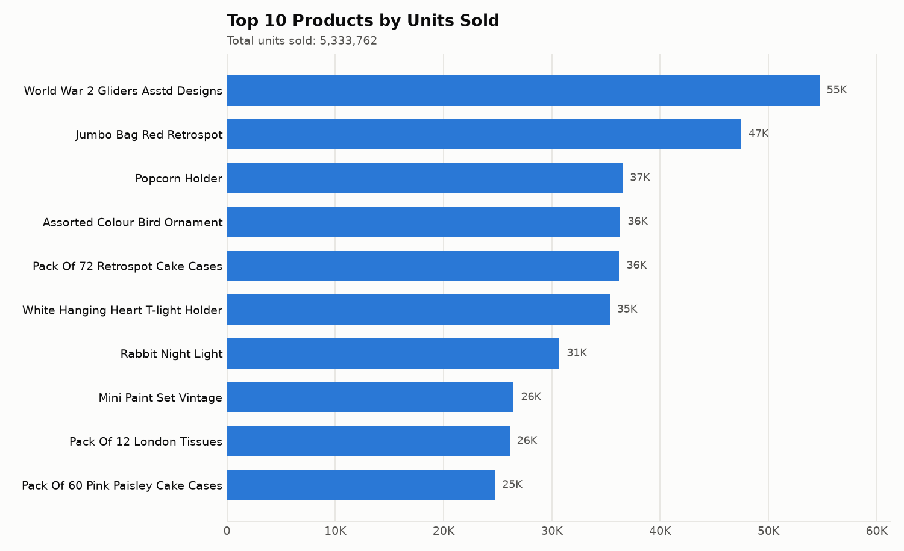

| Rank | Product | Units sold | Share |
|-----:|---------|-----------:|------:|
| 1 | World War 2 Gliders Asstd Designs | 54,711 | 1.03% |
| 2 | Jumbo Bag Red Retrospot | 47,488 | 0.89% |
| 3 | Popcorn Holder | 36,546 | 0.69% |
| 4 | Assorted Colour Bird Ornament | 36,333 | 0.68% |
| 5 | Pack of 72 Retrospot Cake Cases | 36,228 | 0.68% |
| 6 | White Hanging Heart T-Light Holder | 35,348 | 0.66% |
| 7 | Rabbit Night Light | 30,709 | 0.58% |
| 8 | Mini Paint Set Vintage | 26,489 | 0.50% |
| 9 | Pack of 12 London Tissues | 26,107 | 0.49% |
| 10 | Pack of 60 Pink Paisley Cake Cases | 24,748 | 0.46% |

Low-priced items lead on volume, while the top earner (Regency Cakestand, ~£12
each) ranks outside the top 10 by units. Only Jumbo Bag Red Retrospot, White
Hanging Heart T-Light Holder, Rabbit Night Light and Assorted Colour Bird Ornament
appear in both top-10 lists.

### 4. Monthly Sales
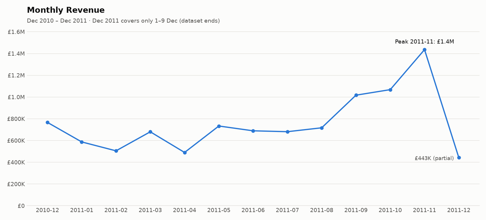

| Month | Revenue | Change vs previous month |
|-------|--------:|-------------------------:|
| 2010-12 | £766,665.09 | – |
| 2011-01 | £587,062.70 | −23.4% |
| 2011-02 | £505,292.29 | −13.9% |
| 2011-03 | £680,301.35 | +34.6% |
| 2011-04 | £490,266.22 | −27.9% |
| 2011-05 | £733,579.66 | +49.6% |
| 2011-06 | £689,417.76 | −6.0% |
| 2011-07 | £681,338.77 | −1.2% |
| 2011-08 | £717,100.45 | +5.3% |
| 2011-09 | £1,017,160.07 | +41.8% |
| 2011-10 | £1,068,097.92 | +5.0% |
| 2011-11 | **£1,436,127.66** | +34.5% |
| 2011-12 | £442,881.55 | −69.2% |

Revenue is fairly flat at roughly £0.5M–£0.77M a month from December 2010 to August 2011, then
climbs through autumn to a peak of **£1.44M in November 2011** (pre-Christmas
wholesale buying). December 2011 looks low only because the dataset ends on
9 December.

Full ranked tables are in [results/summary/](results/summary/) (CSV) and the raw
MapReduce output is in [results/output/](results/output/) (`part-00000` per job).

## Project structure

```
├── backend/
│   ├── main.py                 FastAPI REST API serving the results
│   ├── requirements.txt
│   └── tests/test_api.py       API tests
├── frontend/                   Next.js site that displays the results (see frontend/README.md)
├── hadoop/conf/                single-node Hadoop config (core, hdfs, mapred, yarn)
├── mapreduce/
│   ├── sales_by_product/       mapper.py, reducer.py
│   ├── sales_by_country/       mapper.py, reducer.py
│   ├── top_selling_products/   mapper.py, reducer.py
│   └── monthly_sales/          mapper.py, reducer.py
├── scripts/
│   ├── download_data.sh        downloads the dataset into data/raw/
│   ├── hadoop_start.sh         starts HDFS + YARN (hadoop_stop.sh stops them)
│   ├── hadoop_env.sh           Hadoop environment variables for your shell
│   ├── clean_data.py           cleaning step → data/cleaned/online_retail_clean.tsv
│   ├── verify_results.py       checks MapReduce output against pandas
│   └── visualize.py            graphs + ranked CSV tables
├── tests/test_mapreduce.py     unit tests for every mapper/reducer
├── data/sample/                5,000-row sample of the cleaned data
├── results/
│   ├── output/<job>/part-00000 MapReduce output
│   ├── summary/*.csv           ranked tables
│   ├── graphs/*.png            charts
│   ├── hadoop_screenshots/     HDFS / YARN web UI screenshots from the Hadoop run
│   ├── frontend_screenshots/   screenshots of the frontend
│   └── hadoop_run_log.txt      full Hadoop job log with counters
├── run_hadoop.sh               runs all jobs on Hadoop via Hadoop Streaming
├── run_local.sh                runs the same jobs locally (map | sort | reduce)
└── run_pipeline.sh             end-to-end: download → clean → MapReduce → verify → graphs
```

## How to run

### Prerequisites

- Python 3.8+ and the packages in `requirements.txt`:
  ```bash
  pip install -r requirements.txt
  ```
- For the Hadoop run: Hadoop 3.x and Java 17 (a single-node cluster is enough).

### Option A — on Hadoop

**1. Install Hadoop (one time).** On macOS, Homebrew also installs the Java it needs:

```bash
brew install hadoop
```

On Linux, download Hadoop from https://hadoop.apache.org/releases.html and set
`HADOOP_HOME` and `JAVA_HOME` before running the scripts below.

**2. Start the single-node cluster.** The project's config is in
[hadoop/conf/](hadoop/conf/). The script starts every daemon directly, so it needs
no SSH or sudo setup. It formats HDFS the first time it runs.

```bash
./scripts/hadoop_start.sh
```

`jps` should now list NameNode, DataNode, ResourceManager, NodeManager and JobHistoryServer.

| Web UI | URL |
|--------|-----|
| HDFS NameNode (files, storage) | http://localhost:9870 |
| YARN (running and finished jobs) | http://localhost:8088 |
| MapReduce job history (counters) | http://localhost:19888 |

**3. Run the pipeline on Hadoop.**

```bash
./scripts/download_data.sh          # get the dataset
python3 scripts/clean_data.py       # clean it
./run_hadoop.sh                     # upload to HDFS and run the 4 jobs on YARN
python3 scripts/verify_results.py   # check the results
python3 scripts/visualize.py        # build graphs + tables
```

or all at once: `./run_pipeline.sh hadoop`

**4. Stop the cluster when you're done:** `./scripts/hadoop_stop.sh`

To use Hadoop commands yourself (for example `hdfs dfs -ls /user/$USER/retail/output`),
first run `source scripts/hadoop_env.sh` in your terminal.

`run_hadoop.sh` uploads the cleaned file to `/user/$USER/retail/input`, then runs
each job like this:

```bash
hadoop jar $HADOOP_HOME/share/hadoop/tools/lib/hadoop-streaming-*.jar \
  -files mapreduce/sales_by_country/mapper.py,mapreduce/sales_by_country/reducer.py \
  -mapper "python3 mapper.py" \
  -combiner "python3 reducer.py" \
  -reducer "python3 reducer.py" \
  -input /user/$USER/retail/input \
  -output /user/$USER/retail/output/sales_by_country
```

Then it copies each job's output from HDFS back to `results/output/`. You can
set `HDFS_BASE`, `STREAMING_JAR` and `NUM_REDUCERS` as environment variables.

### Option B — without Hadoop (local simulation)

`run_local.sh` runs the same mapper and reducer scripts, and uses Unix `sort`
for the shuffle and sort step. This is how Hadoop Streaming itself is usually
tested:

```bash
cat data/cleaned/online_retail_clean.tsv \
  | python3 mapreduce/sales_by_country/mapper.py \
  | LC_ALL=C sort -t $'\t' -k1,1 \
  | python3 mapreduce/sales_by_country/reducer.py
```

```bash
./run_pipeline.sh            # full pipeline, local mode
./run_local.sh data/sample/online_retail_sample.tsv   # quick try on the sample
```

(Running on the sample overwrites `results/output/`; run the full pipeline again
to restore the full results.)

### Tests

```bash
python3 -m unittest discover tests                  # MapReduce jobs
python3 -m unittest discover -s backend/tests -t .  # backend API
```

## Hadoop run

The four jobs were run on a single-node Hadoop 3.5.0 cluster (HDFS + YARN) with
Java 17. All four finished with state `SUCCEEDED`, using 2 map tasks and 1 reduce
task each. The output fetched from HDFS matches the local run byte for byte.
The full job log with all counters is in
[results/hadoop_run_log.txt](results/hadoop_run_log.txt).

| Job | YARN application | Wall time | Map task time | Reduce task time | Output written |
|-----|------------------|----------:|--------------:|-----------------:|---------------:|
| sales_by_product | application_1790675894475_0005 | 15 s | 8.9 s | 2.3 s | 140,692 bytes |
| sales_by_country | application_1790675894475_0006 | 19 s | 8.7 s | 2.4 s | 674 bytes |
| top_selling_products | application_1790675894475_0007 | 18 s | 8.9 s | 2.4 s | 127,577 bytes |
| monthly_sales | application_1790675894475_0008 | 19 s | 8.6 s | 2.4 s | 237 bytes |

Wall time is from job submission to completion in the log. Each job reads the
same 44,602,625 bytes from HDFS.

Hadoop counters show how much the combiner saves. Each job reads 519,516 input
records (44.6 MB). The combiner adds up values on the map side, so far fewer
records go through the shuffle to the reducer:

| Job | Map output records | After combiner (shuffled) | Reduce output (keys) |
|-----|-------------------:|--------------------------:|---------------------:|
| sales_by_product | 519,516 | 6,950 | 3,998 |
| sales_by_country | 519,516 | 70 | 38 |
| top_selling_products | 519,516 | 6,950 | 3,998 |
| monthly_sales | 519,516 | 14 | 13 |

| HDFS NameNode | HDFS output directories |
|---|---|
| 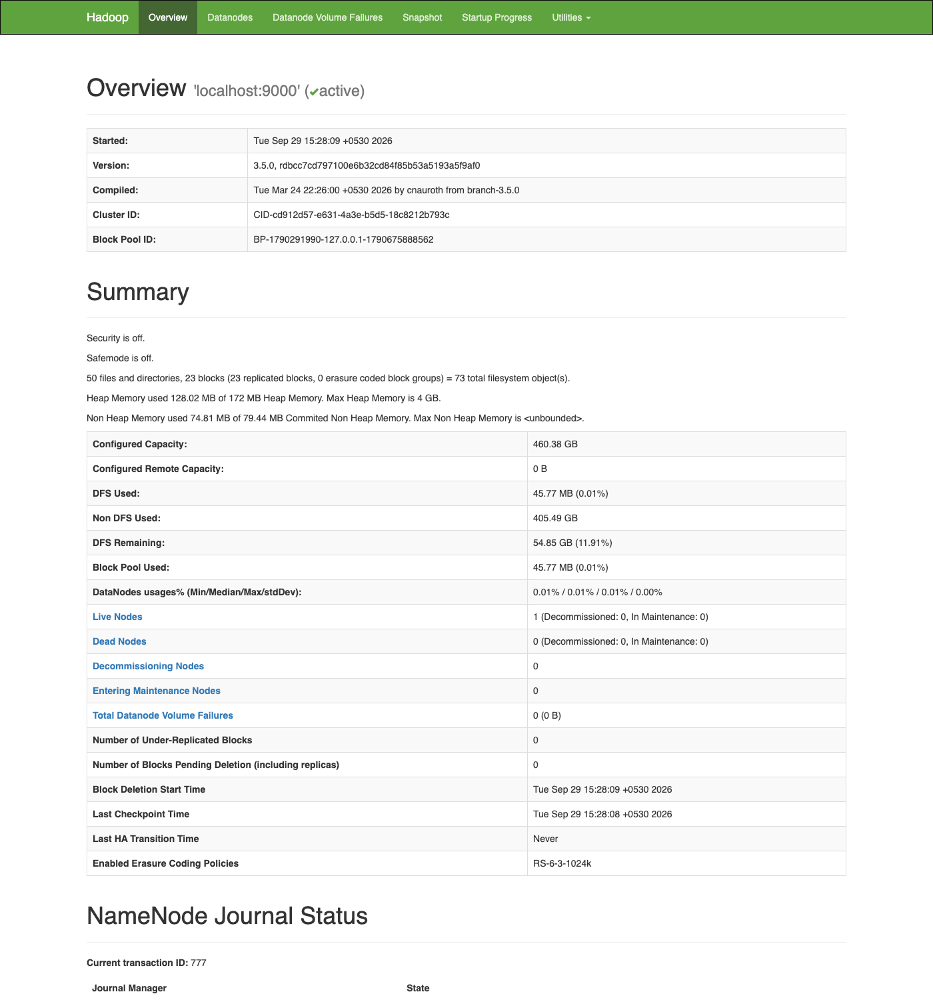 | 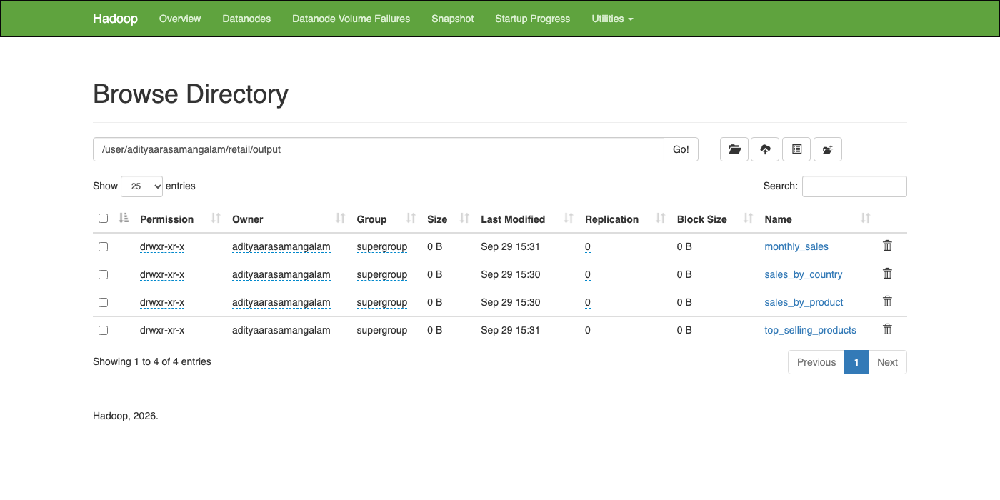 |
| **YARN applications** | **MapReduce job history** |
| 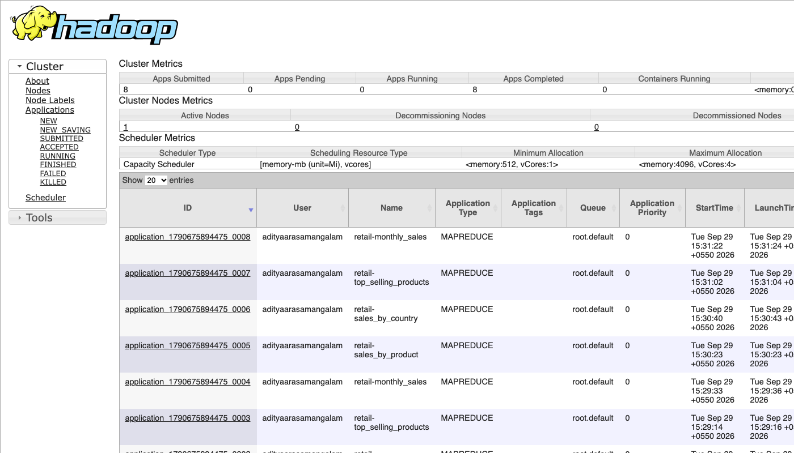 | 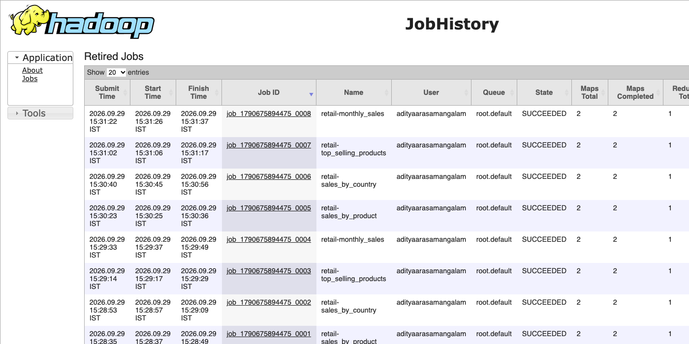 |

## Backend API

[backend/main.py](backend/main.py) is a FastAPI server. It reads the MapReduce
output files and serves them as JSON so a frontend can display them. It re-reads
a file only when that file has changed, so running the pipeline again updates
the API without a restart.

```bash
pip install -r backend/requirements.txt
uvicorn backend.main:app --reload --port 8000     # run from the project root
```

Interactive docs: http://localhost:8000/docs

| Method | Endpoint | Returns |
|--------|----------|---------|
| GET | `/api/health` | status and which job results are available |
| GET | `/api/summary` | total revenue and units, product/country counts, top product, top country, best month |
| GET | `/api/products/revenue?top=10&search=` | Job 1: products ranked by revenue |
| GET | `/api/products/quantity?top=10&search=` | Job 3: products ranked by units sold |
| GET | `/api/countries?top=50` | Job 2: countries ranked by revenue, with % share |
| GET | `/api/monthly` | Job 4: revenue per month with month-over-month % change |
| GET | `/api/graphs` | list of chart URLs (images served under `/graphs/...`) |
| POST | `/api/pipeline/run?mode=local\|hadoop` | starts clean → MapReduce → verify → graphs in the background (returns 409 if already running) |
| GET | `/api/pipeline/status` | `idle` / `running` / `succeeded` / `failed`, plus the last 50 log lines |

Example:

```bash
curl "http://localhost:8000/api/products/revenue?top=2"
```
```json
[{"rank":1,"product":"Regency Cakestand 3 Tier","product_raw":"REGENCY CAKESTAND 3 TIER","revenue":169505.64,"share_pct":1.73},
 {"rank":2,"product":"White Hanging Heart T-light Holder","product_raw":"WHITE HANGING HEART T-LIGHT HOLDER","revenue":100052.42,"share_pct":1.02}]
```

The API returns `503` for results endpoints until the pipeline has produced
output. CORS allows any origin by default; set `RETAIL_CORS_ORIGINS` (comma-separated)
to restrict it. `RETAIL_RESULTS_DIR` points it at a different results folder.

## Frontend

[frontend/](frontend/) is a single-page Next.js site that presents the results.
It reads everything from the backend API, so the numbers on the page are the
reducer output, not hard-coded values.

### Run it

```bash
# terminal 1, from the project root
pip install -r backend/requirements.txt
uvicorn backend.main:app --port 8000          # API at http://localhost:8000/docs

# terminal 2
cd frontend
npm install
npm run dev                                    # open http://localhost:3000
```

If port 8000 is already in use, start the backend on another port and point the
frontend at it: `NEXT_PUBLIC_API_URL=http://localhost:8001 npm run dev`. For a
production build, set the same variable before `npm run build`, then `npm start`.

The top bar shows **Live API** when the backend is reachable. If it isn't, the
site falls back to a saved copy of the results
([frontend/lib/snapshot.json](frontend/lib/snapshot.json)) and shows
**Offline snapshot**, so it still works without the backend.

### Sections

| # | Section | What it shows | API |
|---|---------|---------------|-----|
| – | Hero | Headline totals around a 3D glass crystal with orbiting "records" that pull in as you scroll | `/api/summary` |
| – | Record stream | A 3D corridor of cards, each one line of reducer output (product, country, units, month) | all result endpoints |
| 01 | Overview | KPI cards (revenue, units, products, countries) and the top product, country and month | `/api/summary`, `/api/monthly` |
| 02 | Pipeline | A 3D MapReduce machine (HDFS → Map → Shuffle → Reduce → Output). Clicking a station highlights its stage in the Raw → Clean → HDFS → Map → Combine/shuffle → Reduce flow, with the real Hadoop counters from the run above | Hadoop run log |
| 03 | Monthly sales | Area chart of revenue per month and a timeline of notable months | `/api/monthly` |
| 04 | Products | Carousel of the top 8, then ranked lists by revenue and by units, with search over all 3,998 products | `/api/products/revenue`, `/api/products/quantity` |
| 05 | Countries | Draggable globe with arcs from the UK to every market, a revenue-share donut, and the top markets outside the UK | `/api/countries` |
| 06 | Run it | Starts the pipeline in local or Hadoop mode and streams its log; the page reloads the data when the run finishes | `/api/pipeline/run`, `/api/pipeline/status` |
| 07 | Graphs | The four Matplotlib PNGs from `scripts/visualize.py` in a gallery (bundled copies are used when offline) | `/api/graphs` |

### Screenshots

| Hero | Overview |
|------|----------|
|  | 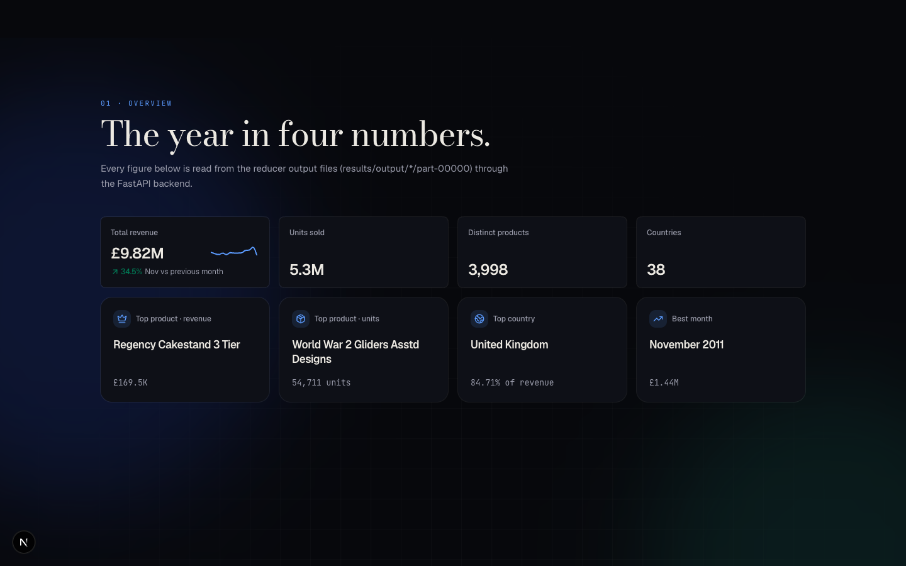 |
| **Pipeline (3D MapReduce machine)** | **Monthly sales** |
| 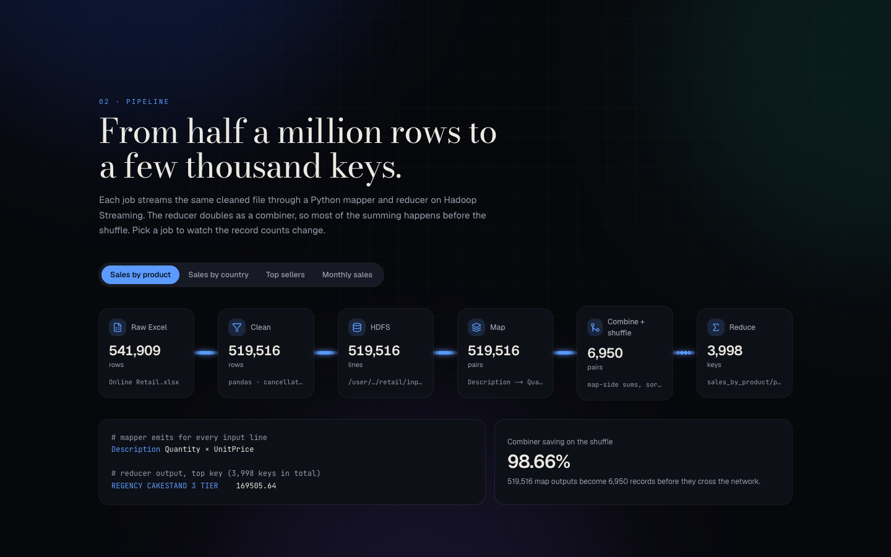 | 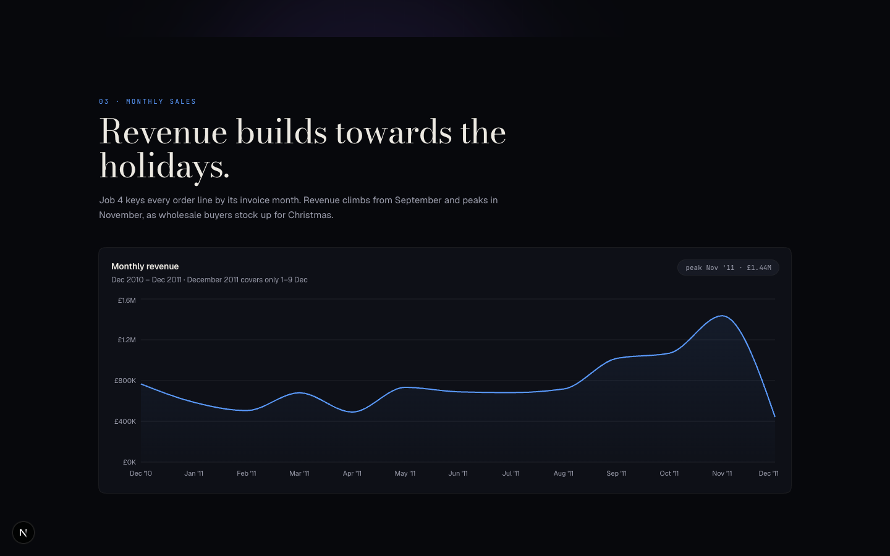 |
| **Products** | **Countries** |
| 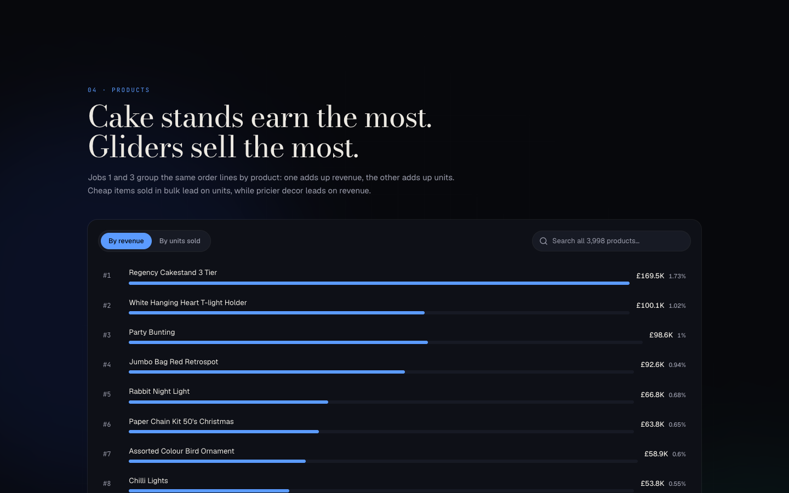 | 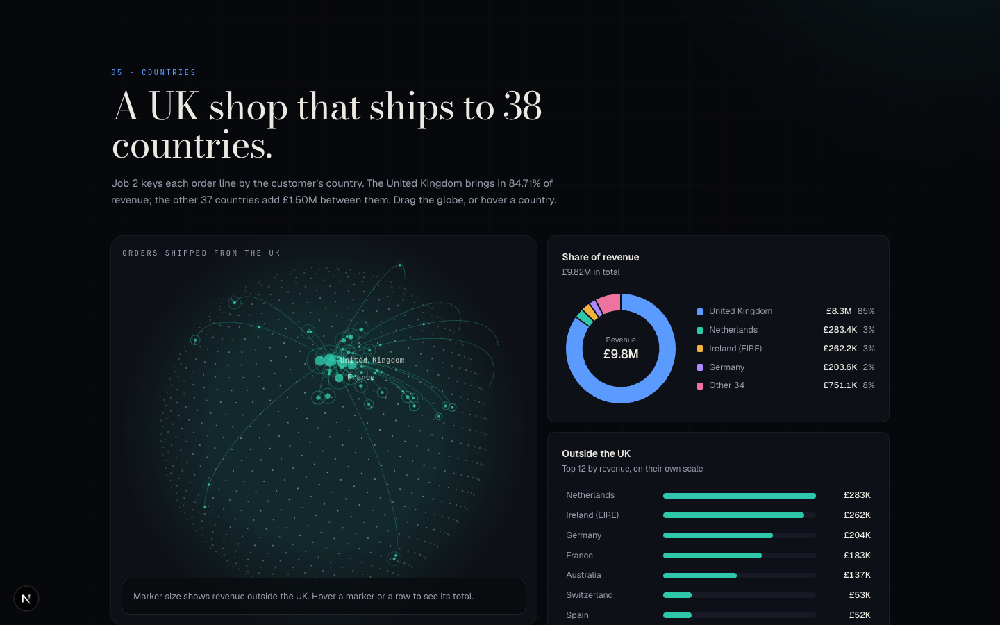 |
| **Run the pipeline** | **Record stream** |
| 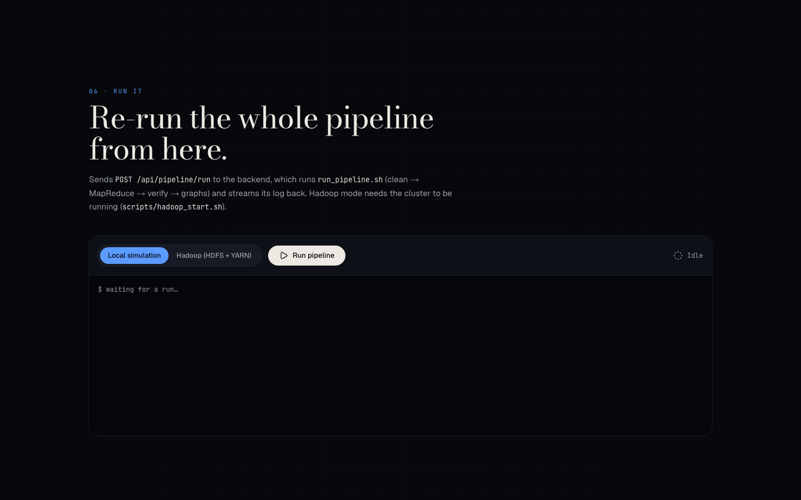 | 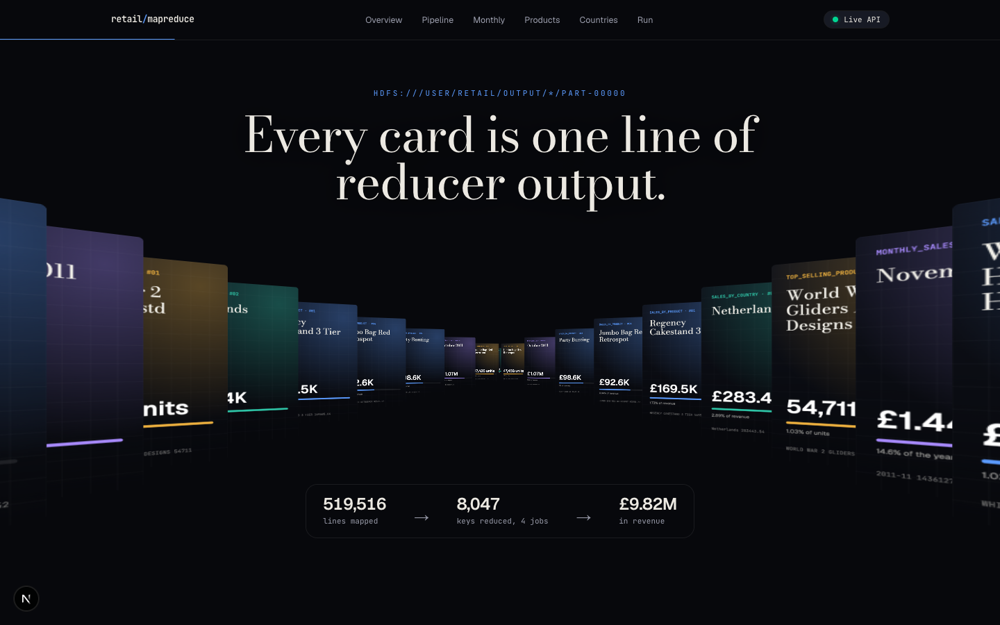 |
| **Matplotlib graphs** | |
| 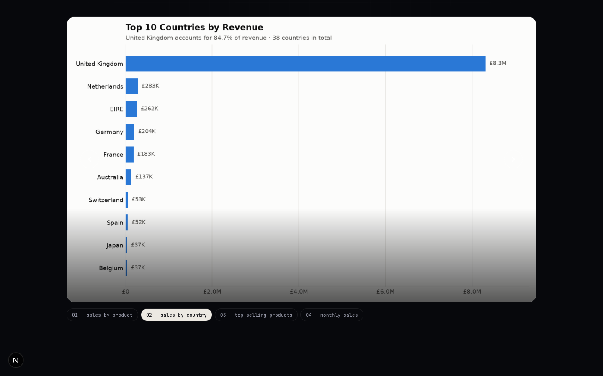 | |

Built with Next.js 16, React 19, Tailwind CSS 4, Recharts, Motion, GSAP and
three.js (React Three Fiber). See [frontend/README.md](frontend/README.md) for
the code layout and component credits.

## Verification

`scripts/verify_results.py` runs all four aggregations again with pandas
`groupby` and compares every key and total with the MapReduce output:

```
[PASS] sales_by_product       keys= 3998  key mismatches=0  value mismatches=0
[PASS] sales_by_country       keys=   38  key mismatches=0  value mismatches=0
[PASS] top_selling_products   keys= 3998  key mismatches=0  value mismatches=0
[PASS] monthly_sales          keys=   13  key mismatches=0  value mismatches=0
```

## Tech stack

Hadoop · HDFS · MapReduce · Hadoop Streaming · Python · pandas (cleaning and verification) · Matplotlib · FastAPI (backend API) · Next.js, React, Tailwind CSS, Recharts, Motion, GSAP, three.js (frontend)

## Dataset citation

Chen, D. (2015). *Online Retail* [Dataset]. UCI Machine Learning Repository.
https://doi.org/10.24432/C5BW33
